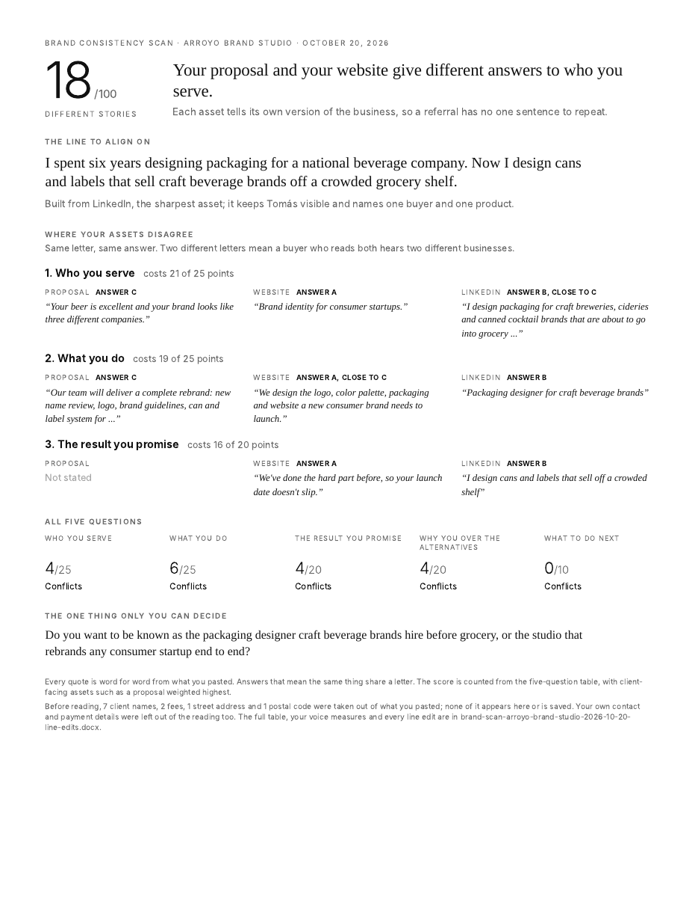

# Brand Consistency Scan

See exactly where your website, LinkedIn and proposals contradict each other, in your own quoted words, and get the one line to align them on. Built by Merigrove.

## Install

**Claude (web or desktop app)**
1. Download `revos-brand-consistency-scan.zip` (do not unzip it).
2. In Claude, open Customize, then Skills, then Upload a skill, and choose the zip. Code execution needs to be on (Settings, Capabilities).
3. Start a new chat and paste the first prompt below.

**Cowork:** Customize, Skills, Install, choose the zip.
**Claude Code:** unzip into `~/.claude/skills/`. The scripts need Python 3.8 or later (the Python that ships with macOS is fine).

## Your first prompt

> Use revos-brand-consistency-scan to check whether my messaging is consistent. Here's my website, my LinkedIn and my last proposal: (paste the text, or attach screenshots or PDFs)

Rough is fine. Paste the home and about pages, your LinkedIn headline and about section, and one recent proposal or sales deck. Client names, fees and contact details are taken out before anything is read, whatever country you and your clients are in.

## What you get

- **A one-page report** (`.html`, prints to one page on your paper: Letter in the US, Canada and Mexico, A4 elsewhere): a score out of 100, the contradictions quoted side by side, the line to align on, how each of five questions scores, and the one decision only you can make.
- **A Word file of line edits** (`.docx`): for each asset, the current line and the line to replace it with, plus the full table, how your voice drifts ("I" against "we", sentence length, reading level) and how the score is worked out.

## How it thinks

Every asset is read for the same five questions a buyer asks: who you serve, what you do, the result you promise, why you, and what to do next. Every answer is quoted word for word. The score is counted from those quotes, with your proposal and other client-facing assets weighted highest, because that is where buyers decide.

## Works where you are

It reads where you are from what you paste (your currency, phone code or address), or asks once. That sets your paper size and how dates read; the edits are written in your own spelling, American or British, counted from your copy. It never assumes a country, and it gives no legal or tax view: it reads your messaging, nothing else.

## It remembers you

After each scan it offers to save your agreed line, your answers and the quotes from each asset. Next time, paste only what you changed: it scores it against your line and shows what moved. In Cowork or Claude Code the file lives in a `merigrove-memory` folder; on claude.ai you download it and attach it next time, or add it to your Project.

## Privacy

Client names (in any language or script, and companies by any legal form: Inc, LLC, Corp, Ltd, Pte. Ltd., Pty Ltd, Sdn Bhd, GmbH and more), fees in any currency, email addresses, phone numbers, addresses and bank or registration numbers are removed before anything is read. They never appear in the report, and the memory file refuses to hold them. The raw text you paste is deleted once the clean copy exists.

## Safety

Read SKILL.md before installing; it is plain text. This skill makes no network calls and sends nothing anywhere.

## Want the full system?

You can see where your story splits; which version of it your best buyers will pay for is a positioning question, and the Merigrove Business Audit scores it: [BUSINESS_AUDIT_URL]
