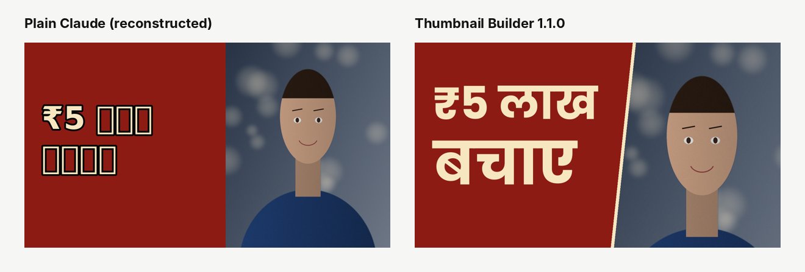
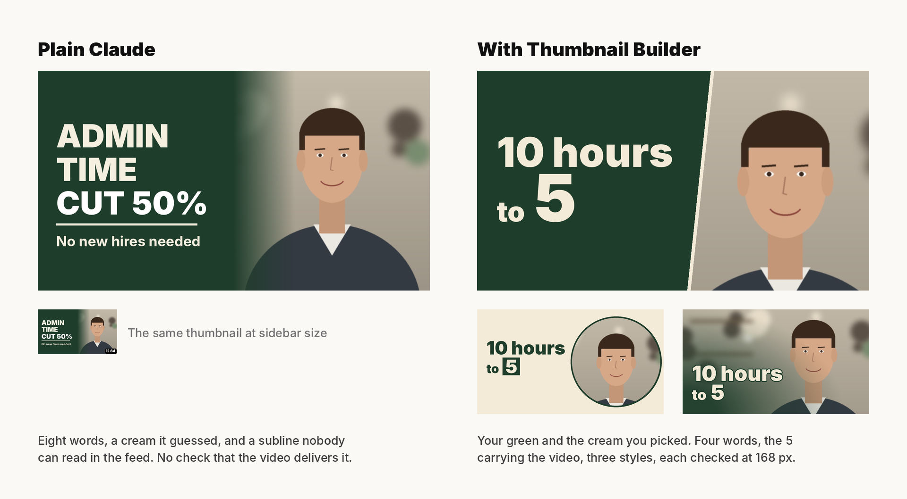

# Before and after

Two comparisons against plain Claude, each on the same brief.

## v1.1.0: a founder who wants the words in Hindi

**Brief** (eval `india-hindi-rupee`): a coaching institute in Pune, title "No-show students se ₹5.2 lakh kaise bachaye", words in Hindi, maroon #8C1C13 and cream #F6E7C1, their font Liberation Sans, the ₹5.2 lakh saving shown at 3:05.

**Plain Claude (reconstructed).** The usual Pillow script: the system's default bold sans, words over the photo with an outline. The rupee sign draws; every Devanagari letter prints as an empty box, and nothing in the script notices. The founder's audience would see a broken thumbnail. Reconstructed by the builder from the pattern plain Claude writes for this kind of brief (`evals/sample-runs/india-hindi-rupee/baseline/baseline.py`); no subagent was available to run plain Claude cold, so treat it as the typical failure, not a measured one.

**Thumbnail Builder 1.1.0.** `check` reads every character against the font's own character map, finds that Liberation Sans has neither Devanagari nor ₹, sets the words in Poppins (open licence, installed, has both) and tells the founder in one line. The letters are shaped with raqm, so the vowel signs sit where they belong. "₹5 लाख" keeps the founder's lakh and is checked against the ₹5.2 lakh in the payoff (a short form may round down, never up). Every readability check passes at 168 px.

## v1.0.1: the blind tester's agency brief

Plain Claude's thumbnail from the blind test beside the skill's bold panel for the same brief, with the poster and cinematic styles beneath. Unchanged in v1.1.0: the brief was a Leeds agency in British English, which the skill now handles by mirroring the founder rather than by default.
