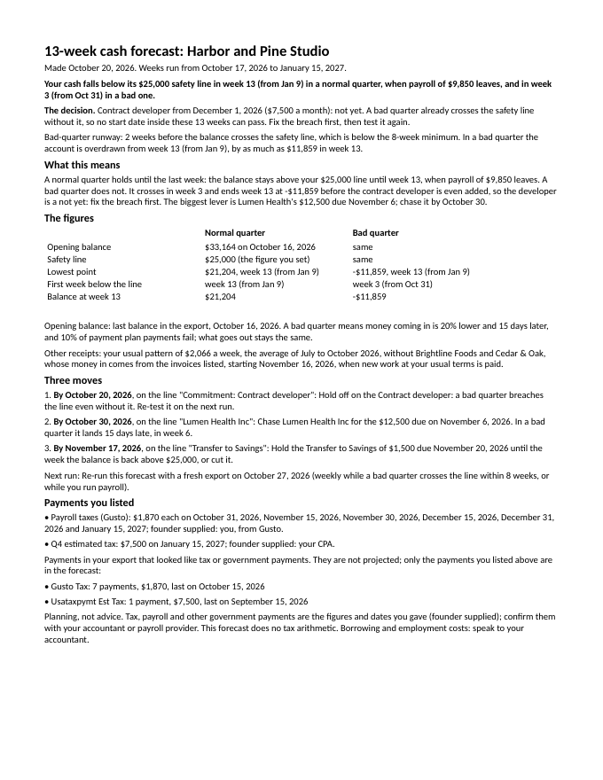

# 13-Week Cash Forecast

Know the exact week your cash runs short, before it does. Drop in a bank export from almost any bank; get 13 weeks in your own currency, a bad-quarter case, your safety line and three dated moves. Built by Merigrove for founders of small businesses, wherever they are.

## Install

**Claude (web or desktop app)**
1. Download `revos-cash-forecast.zip` (do not unzip it).
2. In Claude, open Customize, then Skills, then Upload a skill, and choose the zip. Code execution needs to be on (Settings, Capabilities).
3. Start a new chat and paste the first prompt below.

**Cowork:** Customize, Skills, Install, choose the zip.
**Claude Code:** unzip into `~/.claude/skills/`.

## Your first prompt

> Use revos-cash-forecast to tell me whether we'll make payroll and cover our next tax payment this quarter. Here's my business bank export: (attach the CSV)

Three months of transactions works best. Most banks' CSV export will do: Chase, Bank of America, Wells Fargo, Mercury, DBS, OCBC, Commonwealth Bank, ANZ, Wise, Barclays, HSBC, Lloyds, NatWest, Monzo, Starling, Tide, Revolut Business and others; it reads any export by its column names. You can be rough with everything else, and write figures your own way: "Alder owe us 4.2k due end of the month and always pay late", "R412 000", "1.200,50 €" are all enough.

## What you get

- **A workbook** (`.xlsx`) with live formulas: a Summary, the 13 weeks in a normal quarter and a bad one, your assumptions, every known payment date and every expected receipt. Yellow cells are yours; change a date or an amount and every week moves.
- **A one-page reading** (`.docx`, on Letter or A4 as your country uses): the week your cash first drops below your safety line in each case, the lowest point, bad-quarter runway against an eight-week minimum, three dated moves, and the tax and payroll payments you listed. Ready for your accountant or co-founder.
- **A straight answer on a hire or a big spend:** yes, a later start date (worked out, not guessed), or not yet.

## How it thinks

Cash, not profit. Money arrives when a client pays, not when the work is sold, so every invoice lands on its due date plus however late that client usually is, and a client whose invoices you list is never counted twice. If your income is seasonal, tell it which months are quiet. A bad quarter means money in 20% lower and 15 days later while everything going out stays the same. It reads your bank export itself, works out your currency and whether you write dates day first or month first from the file (or asks once), and checks every row against the running balance, so the forecast opens on the bank's own figure.

It does no tax arithmetic and holds no country's tax calendar. Tax, payroll taxes and other government payments go in as you list them (what, how much, when or how often), from your accountant or payroll provider, each labelled as your figure.

## It remembers you

After each run it offers to save your bank's layout, your currency and date order, your regular bills, the tax and payroll payments you listed and how your clients pay. In Cowork or Claude Code it saves a file in a `merigrove-memory` folder; on claude.ai it hands you the file to download, and you attach it next time or add it to your Project. Next month it is one export and one question (a short export is fine: your saved bills carry forward), and it tells you how the last forecast compared with what actually came in.

## Safety

Read SKILL.md before installing; it is plain text. This skill makes no network calls and sends nothing anywhere. Your bank export stays in your chat or on your machine. It is a planning tool, not financial, tax or legal advice.

## Want the full system?

Your forecast names the week. Why the cash leaks is a structural question across pricing, terms and delivery; the Merigrove Business Audit scores it: [BUSINESS_AUDIT_URL]
