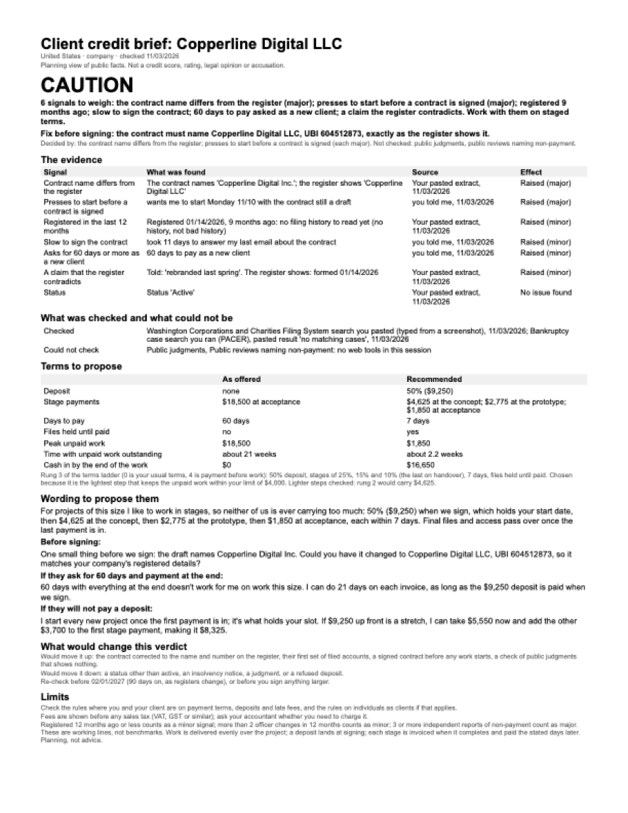

# Client Credit Check

Know before you sign whether a new client is likely to pay you: a Go, Caution or Stop verdict with every finding sourced and dated, and the deposit and payment terms to match, worded so you can send them. Built by Merigrove for founders of service businesses, wherever you and your clients are.

## Card copy

Before you sign, find out whether a new client is likely to pay. Give it the company name and country. It checks the public register, gives a Go, Caution or Stop verdict with every finding sourced, and works out the deposit and payment terms that keep your unpaid work within what you can afford.

## Install

**Claude (web or desktop app)**
1. Download `revos-client-credit-check.zip` (do not unzip it).
2. In Claude, open Customize, then Skills, then Upload a skill, and choose the zip. Code execution needs to be on (Settings, Capabilities). Web search helps but is not required.
3. Start a new chat and paste the first prompt below.

**Cowork:** Customize, Skills, Install, choose the zip.
**Claude Code:** unzip into `~/.claude/skills/`.

## Your first prompt

> Use revos-client-credit-check. New client: (company name and country), (the fee), about (how many weeks), and they want (their payment terms). Here's anything I have: (paste emails, notes, a register page).

Rough is fine: "Sunrise Provisions Inc., Charlotte NC, $45k for 12 weeks, they want 90 days after delivery, I can't carry more than $10k unpaid" is enough to start.

## What you get

One Word document (and a PDF when your setup can make one), `Client credit brief <Client> <date>.docx`, one page:

- **Verdict:** GO, CAUTION or STOP, one sentence why, what decided it, and anything to fix before signing (for example a contract that names the wrong legal form).
- **The evidence:** up to eight findings, each in the source's own words with the page and the date it was checked, or "you told me".
- **What was checked and what could not be:** every source used, and every gap with its reason, including any part of a pasted register page that did not come through. Unchecked never reads as clean.
- **Terms to propose:** their terms against the recommended ones: deposit, stage payments, days to pay, files held until paid, the peak unpaid work you would carry, for how long, and the cash in by the end of the work, in your currency.
- **Wording to propose them:** a paragraph in your voice, using your names for the stages, that never mentions the check, plus replies to what the client actually asked for ("can we do 60 days and pay at the end?", "net 90, billed at month end", "we don't pay deposits").
- **What would change this verdict:** the evidence that would move it, and a re-check date.
- **Limits:** the planning line, a rules reminder and the sales tax line.

## How it thinks

- A fixed rule turns the findings into the verdict, so the same facts give the same answer, and you can see why.
- Every threshold (company age, officer changes, deposit sizes) is a working default shown in the brief. You can change any of them; none is a benchmark.
- The terms are the lightest that keep the unpaid work within your own limit: a clean client is not insulted, a risky one is not given credit.
- It is not a credit score, it says nothing about what any law allows, and it never accuses anyone.

## It remembers you

After each run it offers to save your limit, usual terms, how you like the wording, and a log of the clients you checked with their verdicts. Tell it later who signed and who paid late, and it shows your own counts by verdict. In Cowork or Claude Code it saves a file in a `merigrove-memory` folder; on claude.ai it hands you the file to attach next time or add to your Project.

## Safety

Read SKILL.md before installing; it is plain text. The scripts make no network calls and send nothing anywhere. When your Claude session has web search or fetch, the skill may look up the client business on its country's public company register, official insolvency and notices sources, published judgments, review sites naming the business, and the business's own website. It never looks up individuals, home addresses, personal finances or social media. Nothing you paste is sent anywhere else. Planning, not legal, financial or tax advice.

## Want the full system?

This brief protects one deal. How much of your year rests on a handful of clients, and what a late payer would do to your cash, is a question about how predictable your income is; the Merigrove Business Audit scores it: [BUSINESS_AUDIT_URL]
