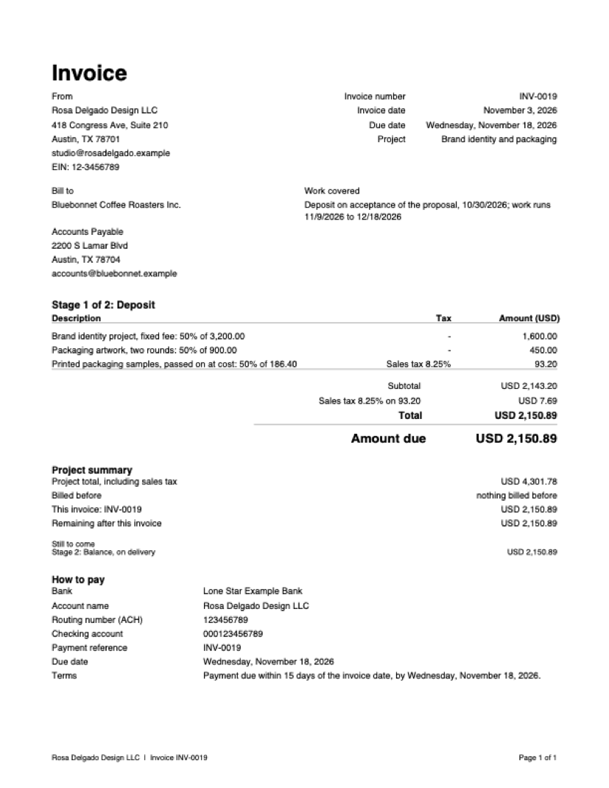

# Invoice and Terms Builder

Send invoices that are right first time: give it your details, the client and the work, and get a finished invoice as PDF and Word, totals checked and the due date written out. Built by Merigrove for small businesses anywhere.

## Install

**Claude (web or desktop app)**
1. Download `revos-invoice-and-terms.zip` (do not unzip it).
2. In Claude, open Customize, then Skills, then Upload a skill, and choose the zip. Code execution needs to be on (Settings, Capabilities).
3. Start a new chat and paste the first prompt below.

**Cowork:** Customize, Skills, Install, choose the zip.
**Claude Code:** unzip into `~/.claude/skills/`.

## Your first prompt

> Use revos-invoice-and-terms to make an invoice. Here is what I have: (paste your last invoice, the client's email, your proposal, or just tell me who it is for, what you did and when, the price, and how you get paid)

Rough is fine: "Invoice Harbor Street Bakery for the website, 3 days at $950 a day plus $212.40 travel, last invoice was 0041, pay in 15 days" is enough to start. It shows you a draft in the first reply and asks only what is missing.

## What you get

1. **`Invoice <number> <Client> <date>.pdf`** and the same as **`.docx`**, the main file:
   - the invoice number, carried on from your last one, and today's date
   - the due date written as a date with its weekday, never just "net 30"
   - your details and the client's, with their PO or reference if they need one
   - the dates the work covers, on their own line
   - lines, subtotal, your tax lines exactly as you supplied them (a line with no tax shows a dash), total and amount due, each total with its currency code
   - for project work: a deposit or stage invoice with a project summary (project total, billed before, this invoice, what remains) and a short "still to come" list of the later stages, on one page
   - how to pay, the reference to quote, your payment terms and any wording your accountant gave you
2. **`Invoice register.xlsx`**: every invoice you have issued, what is owed and by when (live formulas), your billing plans, any voided numbers with their reason, and your settings. Give it your own invoice spreadsheet and it reads that first, telling you what it could and could not read.
3. In chat: the invoice number, total, due date and anything to check, so you can see it without opening a file; payment terms wording for your proposals and contracts, ready to paste; and, if an invoice is already overdue, one polite reminder to paste into an email.

On request: a preview PDF of each later stage, and the payment terms as a one-page Word file.

## How it thinks

- Every figure is worked out by a script and the finished file is read back to check it ties out. Nothing is added up by eye.
- Tax only as you supply it: the name, rate and number come from you and your accountant. It never states a tax rate, never says a line is exempt and never says what any law requires.
- It never backdates: an invoice is dated the day you issue it, and the work dates have their own line.
- A late fee goes on an invoice only if your contract already has one. If you have decided your own, it goes, in your words, into your payment terms for the next contract. It never suggests a figure or calls one standard.
- An IBAN is checked by its own check digits before it is printed.
- Your currency, the way you write numbers (1,234.56, 1.234,56 or 2,11,770.00), your date style and paper size; invoices in another language if you want.
- A wrong invoice is never edited: you get a credit note and a new invoice.

## It remembers you

After each run it offers to save your details, payment details, tax setup, number format, clients, open billing plans and the register. Next time you say "send Lumen stage 2" and it asks nothing. In Cowork or Claude Code it saves a file in a `merigrove-memory` folder; on claude.ai it hands you the file to download, and you attach it next time or add it to your Project. The file holds your payment details, so keep it private.

## Safety

Read SKILL.md before installing; it is plain text. This skill makes no network calls, looks nothing up and sends nothing anywhere; you send the invoice. It is a record and planning tool, not tax, accounting or legal advice: confirm your tax lines and any late fee with your accountant or lawyer.

## Card copy (skills page)

Invoices that get paid on time because they are right first time. Give it your details, the client and the work. You get a clean invoice as PDF and Word in your currency, your tax details as you supply them, a due date written out, and a deposit or stage invoice where it fits. Already overdue? One polite reminder.

## Want the full system?

Your invoice is right and your terms are written down. Whether your offers and billing rhythm give you cash you can count on, month to month, is the next question; the Merigrove Business Audit scores it: [BUSINESS_AUDIT_URL]
