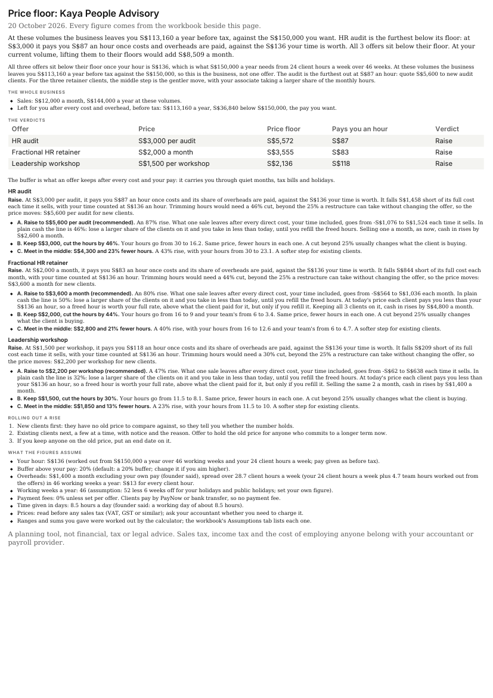

# Price Floor Calculator

Find the lowest price each of your offers can charge with your own hours paid, what today's price actually pays you an hour, and whether to raise, hold or restructure. Built by Merigrove for founders of service businesses.

## Install

**Claude (web or desktop app)**
1. Download `revos-price-floor-calculator.zip` (do not unzip it).
2. In Claude, open Customize, then Skills, then Upload a skill, and choose the zip. Code execution needs to be on (Settings, Capabilities).
3. Start a new chat and paste the first prompt below.

**Cowork:** Customize, Skills, Install, choose the zip.
**Claude Code:** unzip into `~/.claude/skills/`.

## Your first prompt

> Use revos-price-floor-calculator to check whether I'm charging enough. Here's what I sell and what it costs me: (paste a price list, a proposal, your monthly costs, or just describe it)

You can be rough, in your own currency. "A brand project at about $2,400, takes me 40 to 50 hours, I pay a copywriter $300" is enough to start.

## What you get

- **A workbook** (`.xlsx`) with live formulas: Summary, Inputs, Floors, Options and Assumptions. Yellow cells are your inputs; change one and every floor updates.
- **A one-page summary** (`.html`, prints to PDF) with a verdict per offer, the reasoning, the price change options with their numbers, and every assumption it made.
- **What each offer pays you an hour** once costs and a share of your running costs are paid, set beside what your hour is worth.
- **The whole business:** at the volumes you give, what the business leaves you a year before tax against the pay you want.
- **The options when a price is too low:** a raise (with how many clients you could lose, in plain cash and counting freed hours at your rate), a restructure (same price, fewer hours, with the hours before and after), or a step in the middle.

## Wherever you are

Your currency, your number style, your working year, and the paper size and date order your country uses. Type figures the way you always do: "2.420 €", "1.200,50", "4,5 horas", "₹2.4 lakh" or "$1,200" all read correctly, and the summary writes them back your way. If a figure could be read two ways, it asks rather than guesses. It asks how many weeks you work once your holidays and public holidays are out (46 if you don't say, shown as an assumption you can change). Prices are entered before any sales tax (VAT, GST or similar); ask your accountant whether you need to charge it. If you give your pay after tax, it still finishes: any raise it finds stands, and anything it would hold or restructure is marked provisional until you give a before-tax footing (what you would pay someone to do your part works, with no tax involved). It never works out tax.

## How it thinks

Your hours are never free. Every hour you spend on a client is priced at your rate, and your own pay is never also counted in your running costs. The floor is the least an offer can charge, not what it is worth; what the market will pay sits above it.

## It remembers you

After each run it offers to save your offers, costs, the pay you want and your hours. In Cowork or Claude Code it saves the file in a `merigrove-memory` folder; on claude.ai it hands you the file to download, and you attach it next time or add it to your Project. Keep the memory file and next time a cost changes, the re-run takes about a minute and shows what moved.

## Safety

Read SKILL.md before installing; it is plain text. This skill makes no network calls and sends nothing anywhere. It is a planning tool, not financial, tax or legal advice.

## Want the full system?

Your floor is set. Whether the market will pay above it is a positioning question; the Merigrove Business Audit scores that for you: [BUSINESS_AUDIT_URL]
