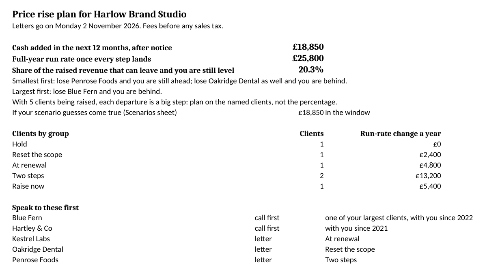

# The Price Rise Pack

Raise your fees and know how many clients you can lose. Paste your clients and what each pays; get who to raise, by how much and from when, a letter for each client, the answers to pushback, and what the rise adds to your cash over the next twelve months, after notice. Built by Merigrove for founders of service businesses, wherever you and your clients are.

## Install

**Claude (web or desktop app)**
1. Download `revos-price-rise-pack.zip` (do not unzip it).
2. In Claude, open Customize, then Skills, then Upload a skill, and choose the zip. Code execution needs to be on (Settings, Capabilities).
3. Start a new chat and paste the first prompt below.

**Cowork:** Customize, Skills, Install, choose the zip.
**Claude Code:** unzip into `~/.claude/skills/`.

## Your first prompt

> Use revos-price-rise-pack to plan a price rise for my clients. Here they are, with what each pays: (paste a sheet, an invoice export, or just names and figures)

You can be rough: "Hartley 1,800 a month since 2021, about 14 hours; Penrose 950, 9 hours; new clients pay 3,000 for about 12 hours; 30 days' notice" is enough to start. A notes column, a client listed twice or a notice like "3 months to quarter end" is fine: you get a first plan in the first reply, then at most five questions.

## What you get

**`Price rise plan <date>.xlsx`**, a workbook with live formulas (yellow cells are your inputs):
- **Summary:** cash added in the next 12 months after notice and the full-year run rate, how many clients can leave before you are worse off (as a share and by name), clients by group, the two or three clients to ring first, flags and the assumptions that move the answer most.
- **Plan:** every client's group, reason, new fee or fees, dates with weekdays, gap left to target, notice and where it came from, call first, cash, and READY or HOLD for the letter.
- **Break-even:** per client and for the whole list, departures smallest first and largest first, and a loss table.
- **Scenarios:** put 1 beside anyone you think might go and watch the net change.
- **Exceptions:** every concession with its end date and its cost.
- **Outcomes:** filled in when you come back and say who said yes.
- **Assumptions:** every rule and default in plain words.

**`Price rise letters <date>.docx`**:
- **How to send these:** the order, who to ring first, when to send, the reminders and what to do on silence.
- **The call outline** for the clients you ring first.
- **The letters by group**, with the rule for the reason.
- **Client by client:** one page each, filled in with the client's name, fee, date and the one true reason, marked READY or HOLD.
- **Replies to pushback:** four replies, each in a version that holds the fee and one that trades something for something, with the cost.
- **Before you send:** the checklist and any open items.

Both files are dated the day they are made. Ask for a change and they are rebuilt under the same names, with the earlier copies moved into a `superseded` folder, so only the current letters sit beside your plan. The files carry your business name, not ours.

Plus a memory file, if you approve, so the next round starts where this one ended.

## How it thinks

- **No blanket rise.** Each client is held, raised now, raised in two dated steps, raised at renewal, offered a scope reset, or given a price to keep. Clients already paying what new clients pay are held and told nothing.
- **No single step above 20%** (you can change it). A bigger gap closes in two dated steps, never one shock.
- **Dates from your own terms.** Your notice, your billing day, renewal dates and price locks. Unknown notice uses a 60-day planning default and holds that letter until you confirm. It never says a date meets a contract or a law, and never backdates.
- **One true reason per letter,** from what you told it and true for that client: what new clients pay, set beside that client's own hours; how the work has grown, written to them; when your fees last changed; or a cost you can put a figure on. Never "costs have gone up" without your figure, never "everyone is doing it".
- **Every figure is worked out by the scripts,** including a break-even checked against every possible combination of departures.

## Wherever you are

Your currency, your number style and your date order. "1.250,00 €", "2.5k/mo", "1.2 lakh" and "$4,000 per project" all read correctly and are written back your way. Enter fees before any sales tax (VAT, GST or similar); ask your accountant whether you need to charge it. If you are not sure, it proceeds as supplied, labels the figures and holds the letters. It never works out tax.

## It remembers you

After each run it offers to save your anchor, rules, notice terms, sign-off and the plan as sent. Come back after the letters have gone, say who accepted, pushed back or left, and it measures what the rise actually added, logs every concession with its end date, writes the confirmations and plans the next wave. In Cowork or Claude Code the file lives in a `merigrove-memory` folder; on claude.ai you download it and attach it next time or add it to your Project. You can choose to store client initials only.

## Safety

Read SKILL.md before installing; it is plain text. This skill makes no network calls, looks nothing up and sends nothing anywhere: no letter is sent, and your client list stays in your chat and your own folder. It is a planning tool, not financial, tax or legal advice.

## Card copy (skills page)

**The Price Rise Pack.** Usually the fastest profit lever a service business has, and the one founders put off. Tell it your clients and current fees; it says who to raise, by how much and when, then writes the client letters, the replies to pushback, and what the rise adds to cash over the next twelve months, after notice, with how many clients you can lose and still be level.

## Want the full system?

Your rise is planned on what clients pay today. Whether your price sits where the market will pay, and what justifies the next rise, is a positioning question; the Merigrove Business Audit scores it: [BUSINESS_AUDIT_URL]
