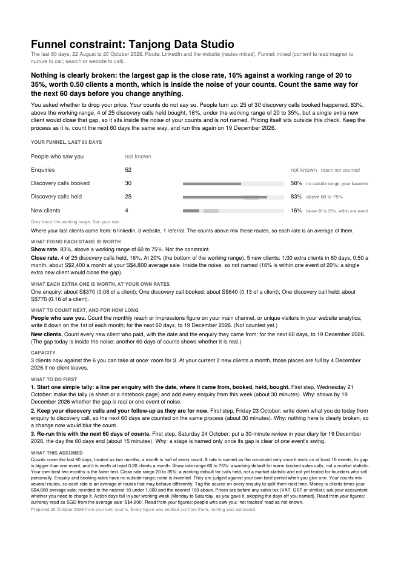

# Funnel Constraint Finder

Find the one stage of your funnel costing you the most customers, from your own rough numbers, and what fixing it is worth in clients and money a month. Built by Merigrove for founders of small service businesses.

## Install

**Claude (web or desktop app)**
1. Download `revos-funnel-constraint-finder.zip` (do not unzip it).
2. In Claude, open Customize, then Skills, then Upload a skill, and choose the zip. Code execution needs to be on (Settings, Capabilities).
3. Start a new chat and paste the first prompt below.

**Cowork:** Customize, Skills, Install, choose the zip.
**Claude Code:** unzip into `~/.claude/skills/`.

## Your first prompt

> Use revos-funnel-constraint-finder to find where I'm losing people. Last 60 days, roughly: (enquiries, calls booked, calls that happened, new clients) and what a new client pays me.

Rough is fine. "About 70 DMs, 38 booked, maybe 17 turned up, 6 signed, $1,450 each" is enough to start. You can also attach a calendar or CRM export, or a screenshot. It works in your currency, your date style and your working week, and prints on Letter or A4 to suit where you are.

## What you get

- **A one-page report** (PDF on Letter or A4, plus a text copy) with your funnel stage by stage: each count, each rate, and which stage is the constraint.
- **What fixing it is worth:** extra clients and money a month if that one stage alone improved, with the working on the page so you can check it.
- **What one extra enquiry, booked call and held call is worth** to you, at your own rates.
- **What is not measured yet,** never guessed: what to count, where, and until which date.
- **Three things to do this week,** each with a day and an hour count. One of them answers "should I buy more leads?"

## How it thinks

One stage limits everything below it, so effort anywhere else returns little (the theory of constraints, Eliyahu Goldratt). The skill raises each stage alone to its target and counts what that adds: the biggest gain is the constraint, not the biggest drop-off. It never invents a benchmark. Show and close rates are compared with working ranges, labelled as defaults; every other rate only with your own best months. A rate resting on fewer than ten events is never named. If you are already full, it says so before recommending a single lead.

## It remembers you

After each run it offers to save your funnel and your best rate per stage. In Cowork or Claude Code it saves a file in a `merigrove-memory` folder; on claude.ai it gives you the file to download, and you attach it next time or add it to your Project. Next time it asks only for your new numbers, shows what moved, and uses your own best as the target.

## Safety

Read SKILL.md before installing; it is plain text. This skill makes no network calls and sends nothing anywhere. It works only from the counts you give it, and it is a diagnostic, not a forecast. It gives no tax, accounting or legal advice: prices are taken before any sales tax, and anything on tax or contact rules goes to your accountant or lawyer.

## Want the full system?

You know what limits your funnel. Whether marketing is the business's real constraint, or price, delivery or cash, is the next question; the Merigrove Business Audit scores the whole business: [BUSINESS_AUDIT_URL]
