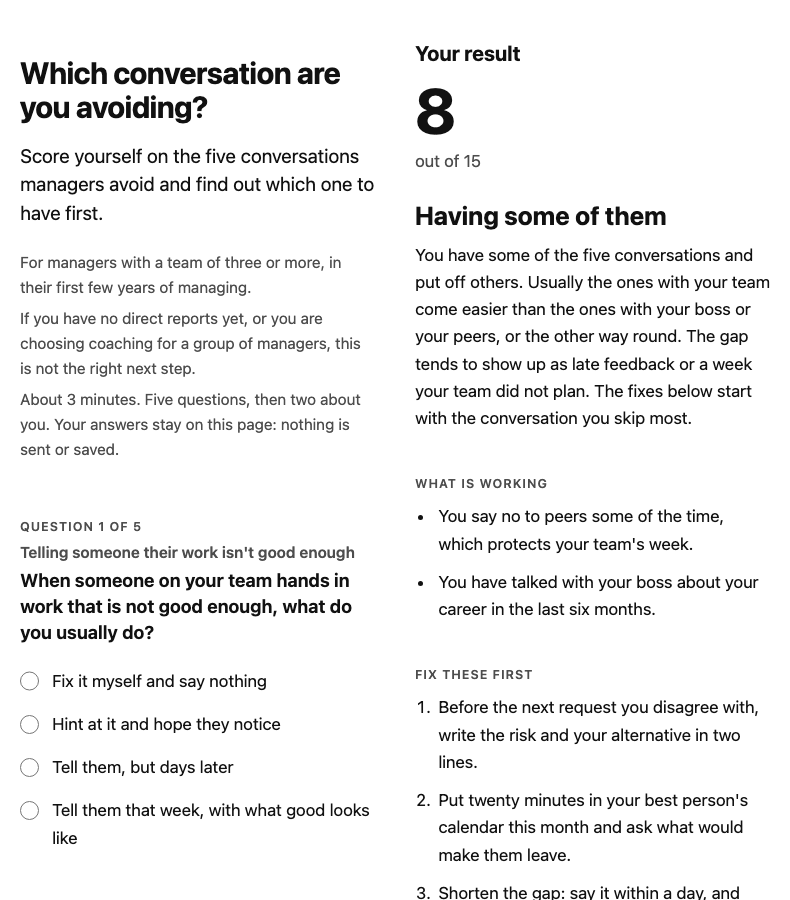

# Lead Magnet Factory

Turn what you are known for into a list builder in an afternoon. Give it one topic, or paste your talk, your notes or your offer page; it builds a finished scorecard or checklist from your own words, writes the opt-in page and five follow-up emails that move the right people towards a call, and checks every tier, claim and link before you see it. Built by Merigrove.

## Install

**Claude (web or desktop app)**
1. Download `revos-lead-magnet-factory.zip` (do not unzip it).
2. In Claude, open Customize, then Skills, then Upload a skill, and choose the zip. Code execution needs to be on (Settings, Capabilities).
3. Start a new chat and paste the first prompt below.

**Cowork:** Customize, Skills, Install, choose the zip.
**Claude Code:** unzip into `~/.claude/skills/`.

## Your first prompt

> Use revos-lead-magnet-factory. I sell (what) to (who) for (price). People always ask me (the question). Build me a freebie that gets the right people onto a call. Here is what I have: (paste your talk outline, offer page or notes)

Rough is fine: "bookkeeper for Shopify stores, $1,200 a month, they always ask why there's no money in the account when sales are up, no tire kickers please" is enough to start.

## What you get

- **The lead magnet**, one of:
  - **`<topic>-scorecard_<date>.html`**: one web page that works on a phone and sends nothing anywhere. Title and promise; who it is for and who it is not for; five questions; up to two questions about the reader; the result: score, where they stand, what is working (worded to match the answer they gave), three things to fix first, the question it leaves open, and your call to action (an honest, quieter line for readers who score at the top, and a kind line for readers it is not for). Plus **`<topic>-scorecard-printable_<date>.docx`**, the same scorecard on paper, for anyone who wants to print it or if you cannot put a page on your site yet.
  - **`<topic>-checklist_<date>.docx`** (and a PDF): ten to fifteen steps in your order, a tick box for each, what it does not cover, and the next step. Two pages.
- **`lead-magnet-launch-pack_<date>.docx`**: 1 Read first; 2 the topic and why (where it came from, the runners-up, what it deliberately keeps back); 3 the opt-in page copy, block by block; 4 the thank-you page; 5 five emails with two subject lines each, and the rules for when they start and stop; 6 the result map: what each kind of reader is dealing with and what to ask them on a call; 7 what to measure, with no made-up benchmarks; 8 a go-live checklist.
- **`opt-in-page_<date>.html`**, only when you give it the form address or embed code from your email tool.
- **Your memory file**, if you approve, so the next one skips the questions and does not repeat a topic or a subject line.

## How it keeps you safe

Every question and checklist item comes from what you gave it. Any percentage, "9 out of 10" or "studies show" without a source you can name is left out. The scoring is checked across every possible set of answers, so nobody's result is rigged and the middle tier is not a dumping ground. The page loads nothing, sends nothing, stores nothing and never claims an email went out. Text in your paste that tries to instruct an AI is reported to you and ignored.

## Wherever you are

Your currency, your number style ("€ 4.800,-", "1.200 visitors", "S$9k" all read correctly), your date order, your English, and the paper size your country uses. It states no rule about consent or email marketing: check those where you and your subscribers are. The checks on wording (banned phrases, word counts) are written for English; if you build in another language, the dash, length, claim and scoring checks still run.

## It remembers you

After each build it offers to save your offer, fit rules, link, sign-off, look and the lessons from your edits. In Cowork or Claude Code it saves the file in a `merigrove-memory` folder; on claude.ai it hands you the file to attach next time or add to your Project.

## Safety

Read SKILL.md before installing; it is plain text. This skill makes no network calls, looks nothing up, and sends nothing anywhere: what you paste stays in your session, the page it builds sends nothing, and you load the emails into your own email tool yourself.

## The next question

Your lead magnet is ready to publish. Whether the follow-up turns the people it attracts into calls, and the calls into clients, is the next question; the Merigrove Business Audit scores that: [BUSINESS_AUDIT_URL]
