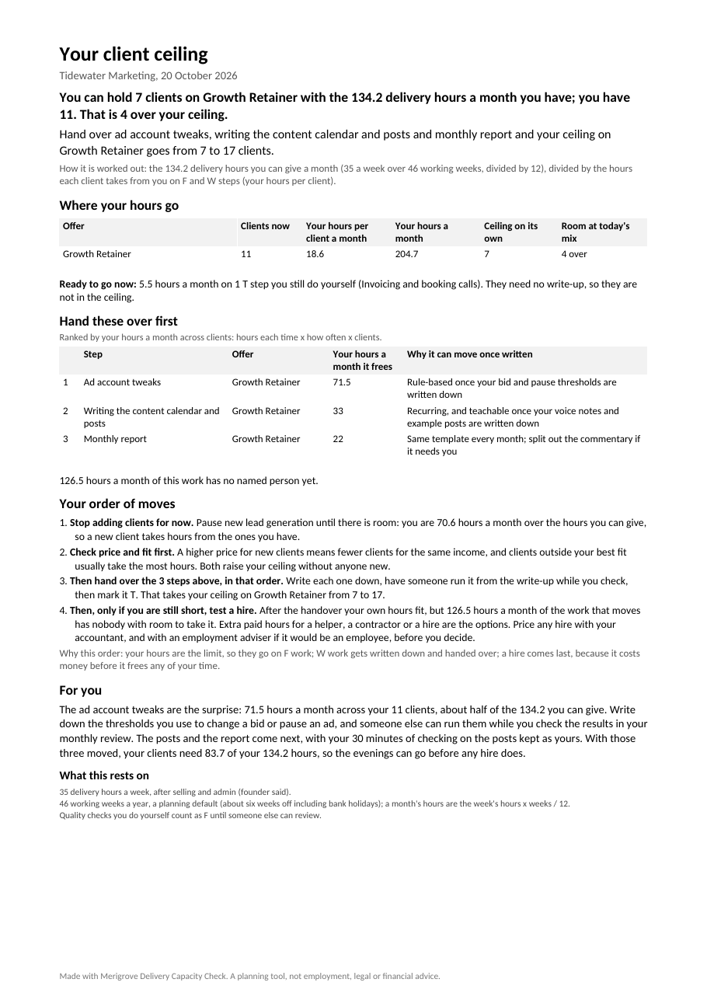

# Delivery Capacity Check

Find your client ceiling, and the three tasks to hand off first. List your delivery steps and rough hours; get how many clients your own hours can hold on each offer, against how many you have, and the order to hand work over. Built by Merigrove for founders of service businesses with one to five people, wherever they are: it uses your own working week, time off, spelling and date style.

## Install

**Claude (web or desktop app)**
1. Download `revos-delivery-capacity-check.zip` (do not unzip it).
2. In Claude, open Customize, then Skills, then Upload a skill, and choose the zip. Code execution needs to be on (Settings, Capabilities).
3. Start a new chat and paste the first prompt below.

**Cowork:** Customize, Skills, Install, choose the zip.
**Claude Code:** unzip into `~/.claude/skills/`.

## Your first prompt

> Use revos-delivery-capacity-check to work out how many clients I can actually handle. Here's what I do for a typical client each month: (paste a checklist or onboarding doc, or just describe it)

You can be rough. "Monthly retainer, 11 clients, a strategy call, weekly check-ins, I write their posts and do a report, maybe 35 hours a week for delivery" is enough to start. Paste a task export (Notion, Asana, a spreadsheet) if you have one. Mention your time off if it is not about six weeks a year, and what each offer pays if you want to see which one pays least for your hours. Write figures the way you normally do (1.200,50 or 1,200.50; RM 18k; 7,5 Std.).

## What you get

- **A one-page reading** (`.docx`): your ceiling against your clients, where your hours go per offer, the three steps to hand over first with the hours each frees, your new ceiling once they move, and the order of moves (price and fit, then handover, then a hire).
- **A workbook** (`.xlsx`) with live formulas: Ceiling, Steps, Load and Handover order. Yellow cells are yours: change a flag, an hour or a client count and every figure updates.
- **Every step flagged:** F (your judgement is what the client pays for), W (you do it only because nobody else knows how yet) or T (someone or something else can do it now), each with its reason.

## How it thinks

Your hours are the limit. They go on the work only you can do; everything you do only because it was never written down gets written down and handed over; a hire comes last, because it costs money before it frees any of your time. Your own checks of work before a client sees it stay yours until someone else can review.

## It remembers you

After each run it offers to save your offers, steps, flags and hours. In Cowork or Claude Code it saves the file in a `merigrove-memory` folder; on claude.ai it hands you the file to download, and you attach it next time or add it to your Project. Next month the re-run takes a minute and shows whether your handovers moved your ceiling.

## Safety

Read SKILL.md before installing; it is plain text. This skill makes no network calls and sends nothing anywhere. It is a planning tool, not tax, legal, employment or financial advice: it never works out tax, payroll costs or what a law requires, and points you to your accountant, payroll provider or lawyer for those.

## Want the full system?

You know your ceiling. Whether to reprice, restructure or hire is what the Merigrove Business Audit scores: [BUSINESS_AUDIT_URL]
