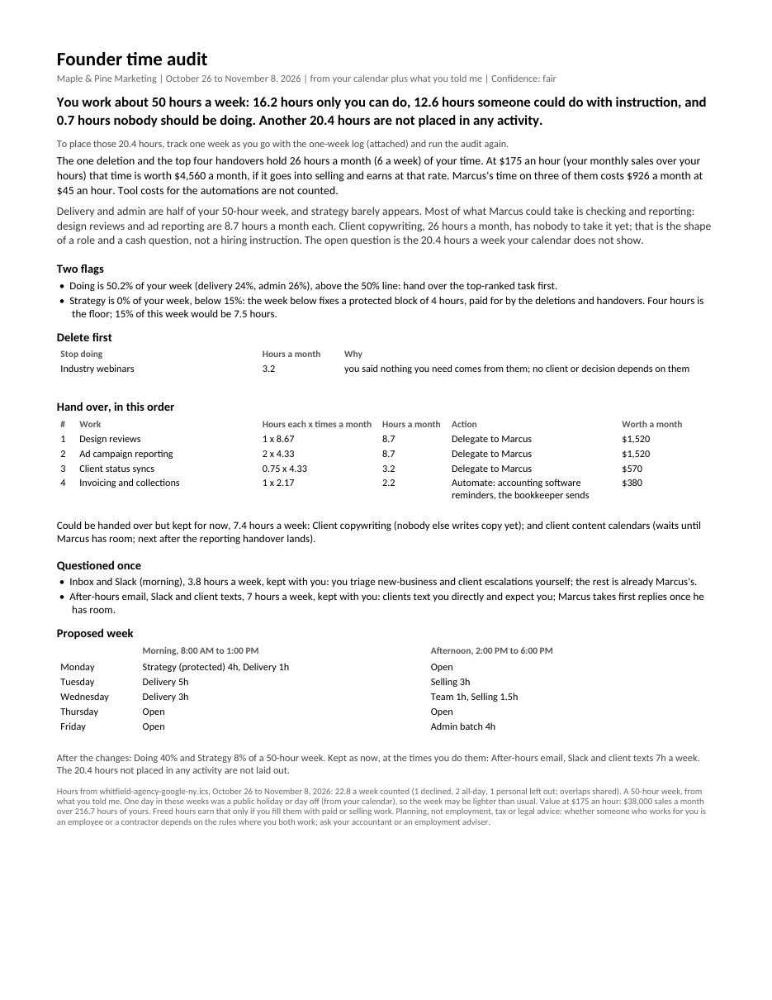

# Founder Time Audit

Find the hours a week you should stop doing. Attach your calendar, or describe last week, and get your hours in three piles, what to stop first, a handover list ranked by the hours it gives back, what that time is worth, and a proposed week. Built by Merigrove for founders of one to five person businesses, wherever they work: your time zone, working week, public holidays, currency and date style come from your calendar or from you, never from an assumed country.

## Install

**Claude (web or desktop app)**
1. Download `revos-founder-time-audit.zip` (do not unzip it).
2. In Claude, open Customize, then Skills, then Upload a skill, and choose the zip. Code execution needs to be on (Settings, Capabilities).
3. Start a new chat and paste the first prompt below.

**Cowork:** Customize, Skills, Install, choose the zip.
**Claude Code:** unzip into `~/.claude/skills/`.

## Your first prompt

> Use revos-founder-time-audit to show me where my week goes and what I should hand over. Here's my calendar export: (attach the .ics or .csv for the last two weeks)

No calendar? Describe it instead: "Monday I did client calls 9 to 12, a site visit till 4, then quotes and emails till 7..." is enough to start.

**Getting the export.** Google Calendar: Settings, Import and export, Export (attach the .ics for your main calendar from the zip). Outlook: File, Save Calendar, or export to CSV. Apple Calendar: File, Export.

## What you get

- **A one-page report** (`.docx`): your week split into only you, someone with instruction, and nobody should; what to delete first; the top five handovers with hours each, times a month and hours a month; what the hours are worth at your rate; the two flags (too much doing, too little strategy); and a proposed week with a protected strategy block.
- **A workbook** (`.xlsx`) with every activity, live formulas and yellow cells to change. Move something to a different pile and the totals update.
- **A handover brief** (`.docx`) for the first person taking work: each task with its hours a week and when it happens now, what stays with you, when to come back to you and the first weeks. Anything you have not told it stays in brackets for you to fill.
- **In the first reply**, before any question: a provisional split of your week, what each helper could take with hours and cost a week, and the clashes in your calendar (double bookings, meetings with someone who is out, calls set in another time zone).
- **For a week from memory:** a one-week time log to fill in as you go, so the next audit is exact.

## How it thinks

It counts before it advises. Repeating meetings are expanded properly in your own time zone (across the clock change in New York, Sydney or London, and with none in Singapore), declined and personal entries are left out, and overlaps are never counted twice. Your working week is read from your calendar (a Saturday morning or a Sunday to Thursday week included), and public holidays and days off come from your calendar or from you. It deletes first, because deleting is free. Then it ranks handovers by hours a month, not by what is easiest, because handing over small tasks frees little. It asks once about any admin you have kept for yourself. It never tells you to hire: it shows you the hours a role would hold.

## It remembers you

After each run it offers to save how your activities are sorted, your team, and what you handed over. Next month, attach a new export and it shows what moved and whether each handover held, usually without a single question. It saves activity labels only, never personal entries or the people you meet.

## Safety

Read SKILL.md before installing; it is plain text. This skill makes no network calls and sends nothing anywhere. It is a planning tool, not employment, tax or legal advice: it computes no tax or payroll cost and states no law. Enter what someone costs you as you know it; questions about employing or contracting someone go to your accountant or an employment adviser.

## Want the full system?

You know which hours to buy back. Whether the business can afford the person to take them is what the Merigrove Business Audit scores: [BUSINESS_AUDIT_URL]
