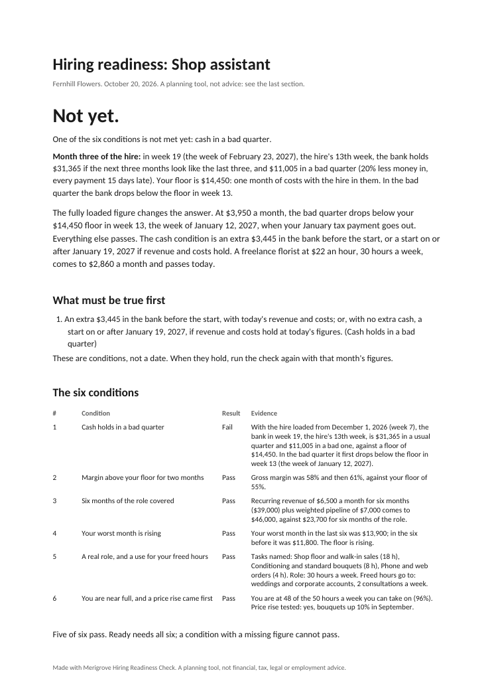

# Hiring Readiness Check

Know if you can afford your first hire before you post the ad. Give your cash, costs, revenue and the role; get Ready, Not yet or No against six conditions, and your bank balance in the hire's third month with the fully loaded cost in it and a bad quarter assumed. Built by Merigrove for founders of businesses with one to five people, wherever you are: your currency, your date style, your English.

## Install

**Claude (web or desktop app)**
1. Download `revos-hiring-readiness.zip` (do not unzip it).
2. In Claude, open Customize, then Skills, then Upload a skill, and choose the zip. Code execution needs to be on (Settings, Capabilities).
3. Start a new chat and paste the first prompt below.

**Cowork:** Customize, Skills, Install, choose the zip.
**Claude Code:** unzip into `~/.claude/skills/`.

## Your first prompt

> Use revos-hiring-readiness to check whether I can hire. Here's what I have: (bank balance, what comes in and goes out a month, the role you have in mind and what it would take off you, or attach a bank export)

You can be rough. "About 25k in the bank, 16k in and 12k out a month, thinking of a part-time assistant for the admin" is enough to start. For the hire's cost, the best figure is the fully loaded monthly cost from your accountant or payroll provider (pay plus whatever goes on top of it where you hire). If you only know the salary, the check runs on that, tells you plainly that it understates the hire, and will not say Ready until you have the loaded figure.

## What you get

- **A report** (`.docx`), verdict first: Ready, Not yet or No, with the one sentence that decides it.
- **Your bank balance in the hire's third month**, in a usual quarter and a bad one (20% less coming in, every payment 15 days late), against a floor of one month of costs.
- **The six conditions**, each passed or failed with your own figures: cash in a bad quarter, margin for two months, six months of the role covered, a rising worst month, a real role with a use for the hours you get back, and being near full after a price rise.
- **What must be true first**, as amounts and conditions, never a date.
- **The contractor alternative**, run through the same bad quarter.
- **The full cost of the hire**: your loaded figure, and a checklist of what it should cover to take to your accountant or payroll provider. The skill never works out taxes or employer charges, in any country.
- **When the answer is Ready:** the role scorecard, a job ad checked for wording that describes the person instead of the work, interview questions mapped to each outcome, and the first 90 days. All jurisdiction-neutral, with one line reminding you to check the employment and anti-discrimination rules where you hire.
- **The workings** (`.xlsx`) with live formulas: change the start date or the cost and watch the floor.

## It remembers you

After each run it offers to save the role, your floors and the month's figures. In Cowork or Claude Code it saves the file in a `merigrove-memory` folder; on claude.ai it hands you the file to download, and you attach it next time or add it to your Project. Next month, paste your figures and the re-check shows which conditions moved.

## Safety

Read SKILL.md before installing; it is plain text. This skill makes no network calls and sends nothing anywhere. It is a planning tool, not financial, tax, legal or employment advice: what goes on top of pay, payroll, contracts and whether someone would be an employee or a contractor go to your accountant, payroll provider or an employment lawyer where you hire.

## Want the full system?

You know what has to be true before you hire. Raising margin and freeing capacity without a hire is what the Merigrove Business Audit scores: [BUSINESS_AUDIT_URL]
