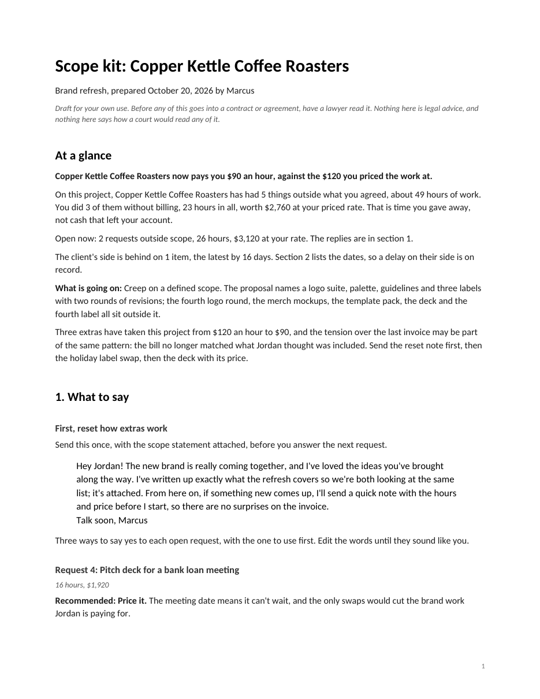

# Scope Guard

Stop doing free work without losing the client. Paste your offer and the requests that feel out of scope; get a scope statement, what the extras have cost you, and the exact words to price the next one. Built by Merigrove for founders of service businesses.

## Install

**Claude (web or desktop app)**
1. Download `revos-scope-guard.zip` (do not unzip it).
2. In Claude, open Customize, then Skills, then Upload a skill, and choose the zip. Code execution needs to be on (Settings, Capabilities).
3. Start a new chat and paste the first prompt below.

**Cowork:** Customize, Skills, Install, choose the zip.
**Claude Code:** unzip into `~/.claude/skills/`.

## Your first prompt

> Use revos-scope-guard. My client keeps asking for extras and I don't know how to charge without annoying them. Here's what they pay, what I agreed to do, and what they've asked for since: (paste the proposal, the messages, rough hours)

You can be rough. "They pay £1,900 a month for 12 posts, I planned 20 hours, and since August they've had two extra reels, a menu graphic and now want a landing page" is enough to start. So is "$8,400 flat for a brand refresh, I estimated 70 hours, they've had a 4th logo round and merch mockups and now want a pitch deck". It works in your currency, your date style and your working day, wherever you and your clients are.

## What you get

- **A scope kit** (`.docx`), the main file:
  - **What to say:** ways to say yes to each open request (price it, next phase, a swap when one is equal effort, and a scoping step for big builds), one recommended, in your voice, plus a short note that resets how extras work from now on.
  - **A one-page scope statement:** the outcome, each deliverable with a number and a "done when", what is included, what is not (including everything this client has already asked for), and what the client owes you, by when.
  - **A creep ledger:** every request, in or out, the hours, and what the work now pays you an hour against the rate you priced it at.
  - **A change request form**, filled in for the first request, and a blank copy.
  - **A goodwill allowance**, if you want one: a small, visible amount of free work instead of invisible leakage.
- **A live spreadsheet** (`.xlsx`) to log the next request; the rates and the months counted recalculate as you add rows.

## How it thinks

A request for extra work is good news: the client wants more of you. The reply says yes with a price or a trade, never an apology and never a telling-off. The hours you have already given away are counted at your own rate, and called what they are: time, not cash.

## It remembers you

After each run it offers to save your offers, rates, your voice and each client's ledger. In Cowork or Claude Code it saves the file in a `merigrove-memory` folder; on claude.ai it hands you the file to download, and you attach it next time or add it to your Project. Next time a client asks for something, the reply takes about a minute.

## Safety

Read SKILL.md before installing; it is plain text. This skill makes no network calls and sends nothing anywhere. It is a planning tool, not legal or tax advice: prices are shown before any sales tax (ask your accountant whether you need to charge it), and anything you plan to put into a contract is a draft for your lawyer to check.

## Want the full system?

You can now price the extras. Whether the offer itself is shaped and priced to stop them arriving is what the Merigrove Business Audit scores: [BUSINESS_AUDIT_URL]
